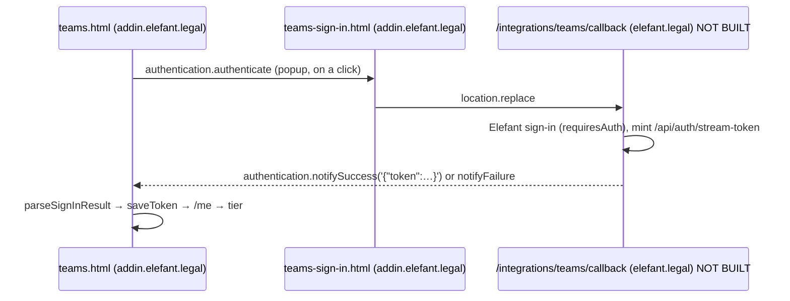

# Teams app: what was built, why, and how to install it (17 Nov 2026)

Issue #78. The owner, 17 Nov: "where's the manifest file? only teams add-in available, which we should add as well btw."

## Decision

Ship a **Teams app of its own: one personal (static) tab**, packaged as a `.zip` (manifest.json + two icons), built from this repository. The Word add-in stays on its XML manifest. The tab is the same Vite build, served from the same origin as the task pane (`https://addin.elefant.legal/teams.html`), and reuses the task pane's settings, sign-in, review call and results components.

Why, from Microsoft's pages (read 17 Nov 2026):

1. **One package for Word and Teams is not possible today.** "Outlook add-ins are the only kind of Office add-in that can be combined with a Teams app. We're working hard to support this feature for Excel, PowerPoint, and Word add-ins too." [Combining an add-in and a Teams app](https://learn.microsoft.com/en-us/microsoftteams/platform/m365-apps/overview-combining-add-in-and-teams-app) (ms.date 2026-06-23). So: two packages, two uploads.
2. **A personal tab is a web page in an iframe.** "Tabs are client-aware webpages embedded in Microsoft Teams, Outlook, and Microsoft 365. They're simple HTML `<iframe/>` tags that point to domains declared in the app manifest" … "Personal (static) tabs … are part of the personal apps that are scoped to a single user and pinned to the left navigation bar". The page must "add the Teams JavaScript client library … and call `microsoftTeams.app.initialize()` after your page loads." [Tabs in Microsoft Teams](https://learn.microsoft.com/en-us/microsoftteams/platform/tabs/what-are-tabs) (ms.date 2026-08-27). Our task pane is already such a page, so this is the smallest shape that reuses it.
3. **A message extension needs a hosted service registered as a bot**, which we do not have: "A message extension is composed of an agent runtime service that you create with Teams SDK and host … so you must register your web service as a bot." (API-based ones need an OpenAPI description and support search only.) [Message extensions](https://learn.microsoft.com/en-us/microsoftteams/platform/messaging-extensions/what-are-messaging-extensions) (ms.date 2026-10-07). Later, if wanted.
4. **The unified manifest and Word.** The Word add-in could move to the JSON manifest on its own (supported on "Office on the web: Yes"; "Excel, PowerPoint, and Word on Windows (Version 2501 (18407.20002) or later) connected to a Microsoft 365 subscription: Yes"; "… on Mac (Version 16.103 (25101427) or later): Yes"; "Office on Windows (perpetual versions): No"; "Office on mobile: No") [Unified manifest overview](https://learn.microsoft.com/en-us/office/dev/add-ins/develop/unified-manifest-overview) (ms.date 2026-10-14). The page does not say "preview" or "generally available" for Word. Moving would drop perpetual Office, and it still would not merge with Teams (point 1), so it is not part of this work.
5. **Manifest version 1.12: Teams only for launch** (owner, 17 Nov: "teams and word are priorities. outlook is next."). Microsoft's TeamsJS page lists "New Teams-only apps | TeamsJS v2.19.0 or later | v1.12 or later" and says "When upgrading your Teams personal tab … to manifest version 1.13 or later, it becomes available across Microsoft 365 hosts by default" ([TeamsJS library](https://learn.microsoft.com/en-us/microsoftteams/platform/tabs/how-to/using-teams-client-library)). Cross-host surfacing needs "greater than or equal to v1.13" ([Integrated apps, cross-host](https://learn.microsoft.com/en-us/microsoft-365/admin/manage/teams-apps-work-on-outlook-and-m365)). The store accepts "a public version of app manifest schema 1.10 or later". Microsoft's other mechanism, `staticTabs[].requirementSet` ([runtime requirements](https://learn.microsoft.com/en-us/microsoftteams/platform/m365-apps/specify-runtime-requirements)), only accepts four dialog capabilities (`dialogUrl`, `dialogUrlBot`, `dialogAdaptiveCard`, `dialogAdaptiveCardBot`; the v1.29 schema's `hostFunctionality` enum). The tab uses none of them, so declaring one just to exclude Outlook would be a false requirement. Widening later is one line: `MANIFEST_VERSION = "1.29"` (newest GA on the [schema reference](https://learn.microsoft.com/en-us/microsoft-365/extensibility/schema/), June 2026); the same manifest also passes the v1.29 schema.

### Sign-in: Elefant's own sign-in in a Teams popup, not Teams SSO

- Teams SSO (`getAuthToken`) yields a Microsoft Entra token, needs an Entra app registration, an Application ID URI and manifest `webApplicationInfo`, and "fails for anonymous users as they aren't Microsoft Entra accounts". [SSO in tabs](https://learn.microsoft.com/en-us/microsoftteams/platform/tabs/how-to/authentication/tab-sso-overview). Elefant accounts are BetterAuth accounts, not Entra identities, and the API does not accept Entra tokens. So SSO would mean backend work and an owner registration for no gain in this slice.
- Third-party sign-in in a tab: identity providers refuse iframes, so "add a page to host the identity provider that Teams client displays inside a pop-up window … Use the `authentication.authenticate()` function". "Authentication flow must start on a page that's on your domain. This domain should also be listed in the `validDomains` section of the manifest. Failure to do results in an empty pop-up." The last page calls `authentication.notifySuccess()` or `notifyFailure()`. "Trigger the authentication flow by a user action." [Configure OAuth authentication for tab](https://learn.microsoft.com/en-us/microsoftteams/platform/tabs/how-to/authentication/auth-tab-aad) (ms.date 2026-03-16).
- Docs silent: whether the page that calls `notifySuccess` must itself be in `validDomains` when it is not the start page. We list `elefant.legal` there anyway (it is ours).



## What is in the repository

| Path | What |
|---|---|
| `scripts/teams-package.mjs` | `pnpm teams:package` → `teams/dist/elefant-teams-<version>.zip`. Constants: `MANIFEST_VERSION`, `TEAMS_APP_ID`, `DEFAULT_TAB_ORIGIN`, `SIGN_IN_ORIGIN` (equal to the redirect in `public/teams-sign-in.js`); env `TEAMS_TAB_ORIGIN` |
| `teams/color.png`, `teams/outline.png` | 192×192 colour, 32×32 white-on-transparent outline ("Full‑bleed color icon 192 × 192 px", "Default (rest) icon 32 × 32 px": [app icons](https://learn.microsoft.com/en-us/microsoftteams/platform/concepts/design/design-teams-app-icon-store-appbar)). Derived from the Elefant mark the web app already ships (monorepo `frontend/apps/nuxt/public/icons/pwa-maskable-512.png`, origin/dev 17 Nov): colour = that full-bleed square scaled to 192; outline = its light strokes as alpha on white, cropped to the symbol, 32 wide. This word repo has only the 80 px "E" task-pane icon, too small for 192 and not the Elefant mark. `accentColor` is the mark's background, `#1A3A4A` |
| `teams.html`, `src/teams.tsx`, `src/TeamsApp.tsx` | The tab page: no office.js; `app.initialize()`, registers the Teams sign-in, then the app |
| `src/components/panels/PastedReviewPanel.tsx` | Paste text → the same `reviewText` + `ReviewResults` as the Word pane, without Insert |
| `src/lib/teams.ts` | The only Teams boundary: start the SDK, sign in through the popup, parse its result. Imported only by the Teams entry, so the Word pane's bundle does not carry TeamsJS |
| `public/teams-sign-in.html/.js` | The popup's first page; redirects to the Elefant Teams callback |
| `src/api/auth.ts`, `src/hooks/useAuth.ts` | `setClickOnlySignIn`: a host whose popup may only open on a click registers its sign-in; `openLoginDialog` then uses it, and the refresh timer does not reopen sign-in. Word path unchanged |

`TEAMS_APP_ID` is the Teams app's own id (any GUID, kept stable so a re-upload is an update). It is not an Entra id, and no Entra id is needed for this slice.

Validation: the zipped manifest was checked against Microsoft's published schemas (`https://developer.microsoft.com/json-schemas/teams/v1.12/MicrosoftTeams.schema.json`, and v1.29 for the widening, both draft-04) with Python `jsonschema`: 0 errors; the same check reports a removed `accentColor`. Draft-04 does not enforce `const`, so `manifestVersion` is guarded by the vitest test instead. To repeat:

```sh
pnpm teams:package && mkdir -p /tmp/teams-pkg && unzip -o teams/dist/elefant-teams-*.zip -d /tmp/teams-pkg
curl -sSfL -o /tmp/teams-schema.json https://developer.microsoft.com/json-schemas/teams/v1.12/MicrosoftTeams.schema.json
uv run --with jsonschema python -c "import json,jsonschema; jsonschema.Draft4Validator(json.load(open('/tmp/teams-schema.json'))).validate(json.load(open('/tmp/teams-pkg/manifest.json'))); print('valid')"
```

Microsoft's own validator is the Developer Portal's store validation (https://dev.teams.microsoft.com/tools/store-validation); it needs a Microsoft sign-in, so it was not run.

## Rough edges (honest 80%)

- **Pro sign-in in Teams needs the web app's `/integrations/teams/callback`**: draft elegantelefant_monorepo#12029 (17 Nov). It signs in through the same `requiresAuth` flow as the Word callback, runs `app.initialize()`, then waits for the user to click **Continue** before it mints the token. It waits because Teams returns `notifySuccess` to whichever app opened the popup, so minting on page load would hand the token to any app that opens the page. On success it sends `notifySuccess(JSON.stringify({token}))`; if the mint fails it sends `notifyFailure(JSON.stringify({error:'token_unavailable'}))`. It loads TeamsJS 2.58.0 from Microsoft's CDN with SRI, the same release the tab bundles. The tab sets no time limit on the popup, and a test holds it open for 10 simulated minutes before Continue. This side is tested through the real `@microsoft/teams-js` against a stand-in Teams host (`agent_tests/teams-host-sign-in.test.ts`): `notifySuccess('{"token":…}')` signs in and stores the token; `notifyFailure('{"error":"token_unavailable"}')`, Teams' own `CancelledByUser`, and a success result without a token surface as "Sign-in failed: …" and keep the previous session. The stand-in host is a jsdom window answering teams-js's postMessage protocol as `window.parent`; it is not Teams. The existing `/integrations/word/callback` speaks only Office's `messageParent`. The new page: `requiresAuth`, fetch `/api/auth/stream-token`, load `@microsoft/teams-js`, `app.initialize()`, then `authentication.notifySuccess(JSON.stringify({ token }))`, or `notifyFailure(JSON.stringify({ error: 'token_unavailable' }))`. It does not load office.js, so it does not depend on #72's `replaceState` fix. The page must call `app.initialize()` before `notifySuccess` (teams-js 2.58.0's `notifySuccess` checks `ensureInitialized(runtime, FrameContexts.authentication)`; the Microsoft page does not say so). From [auth-tab-aad](https://learn.microsoft.com/en-us/microsoftteams/platform/tabs/how-to/authentication/auth-tab-aad): do not send `Cross-Origin-Opener-Policy: same-origin` or `same-origin-allow-popups` on the sign-in pages ("it disrupts the connection to the parent window and causes the authenticate API call to return prematurely with a `CancelledByUser` error"). The token travels in `notifySuccess`'s result string, where Microsoft's sample passes only a localStorage key ("Use localStorage to avoid passing the token via notifySuccess"). That is not possible here: the popup and tab are different origins, and even on one origin the framed tab's storage is partitioned under the Teams top-level site. Accepted. Monorepo work; not done here.
- Free BYOK review works in the tab once a Gemini key is entered in Settings, subject to #71 (the model list).
- In Teams the session is not renewed on a timer (Teams: "Avoid opening the authentication pop-up automatically, as this is likely to trigger the browser's pop-up blocker"), so a Pro user signs in again when the token expires. A "Sign in again" prompt is a follow-up.
- Inside a non-Teams iframe, TeamsJS waits for its initialisation time-out before the tab mounts; outside any frame it fails at once. Only matters when the page is opened outside Teams.
- **CSP `frame-ancestors` is word#85 (the Word lane), not this branch.** The tab must be framable by, per Microsoft's table ([tab requirements](https://learn.microsoft.com/en-us/microsoftteams/platform/tabs/how-to/tab-requirements), [extend personal tab to Microsoft 365](https://learn.microsoft.com/en-us/microsoftteams/platform/m365-apps/extend-m365-teams-personal-tab)): all hosts `https://*.cloud.microsoft`; Teams `https://teams.microsoft.com`, `https://*.teams.microsoft.com`; Microsoft 365 app `https://*.microsoft365.com`, `https://*.office.com`; Outlook `https://outlook.office.com`, `https://outlook.office365.com` (plus Microsoft's `outlook-sdf.*` test hosts). At launch the tab is Teams-only (manifest 1.12), so the Teams and `*.cloud.microsoft` entries are what it needs. The Microsoft 365 and Outlook entries are needed once it widens to 1.13+ ("After it's uploaded to Teams, your personal tab is available in Outlook and Microsoft 365 app"); listing them now costs nothing.
- Teams only at launch (decided 17 Nov). Widening to Outlook and the Microsoft 365 app brings the cross-host store rules (policy 1140.8.1: works in every listed client, and the listing names them).
- `nginx.conf`'s `connect-src` blocks teams-js's start-up fetch of `https://res.cdn.office.net/teams-js/validDomains/json/validDomains.json`: one CSP violation in the console per load, then teams-js uses its built-in host list (which includes `*.cloud.microsoft`, `teams.microsoft.com`, `outlook.office.com`). Harmless today; word#85 may add that host to `connect-src`.
- `SettingsPanel`'s Google AI Studio and Gemini-terms links (shared with Word) open outside Teams without the store's pop-out icon. Follow-up; the tab's own links use `PopOutLink`.
- Theme: the tab does not follow Teams' dark/high-contrast theme (store "Good-to-fix").
- Sign-in failures reach `login()` in `SettingsPanel`, which drops the rejection (`void login()`), as in Word; the user sees no message. Follow-up for both.
- DRY: `TeamsApp` repeats `App`'s three provider setups (~15 lines) and `public/teams-sign-in.*` mirrors `public/sign-in.*`. Kept apart so the Word entry and its tests stay untouched.
- Nothing has been opened in real Teams.

## Sideload it yourself (a person, a Teams account whose policy allows custom app upload)

Microsoft's steps ([Upload your custom app](https://learn.microsoft.com/en-us/microsoftteams/platform/concepts/deploy-and-publish/apps-upload), ms.date 2026-10-09). The tab page must be live: either the deployed `addin.elefant.legal` serving `teams.html` (needs a deploy of this branch; owner-gated), or a local dev server.

1. In this repository: `pnpm install --frozen-lockfile && pnpm teams:package`. For a local test instead: `pnpm certs` once, `pnpm dev`, then `TEAMS_TAB_ORIGIN=https://localhost:3000 pnpm teams:package`, and open `https://localhost:3000/teams.html` in the same browser first to confirm the certificate is trusted. (Microsoft's pages read here do not say whether a localhost tab loads in Teams outside their toolkit; untested.)
2. Open Teams (desktop or https://teams.microsoft.com) signed in with the work account.
3. **Apps** > **Manage your apps** > **Upload an app**.
4. **Upload a custom app** → choose `teams/dist/elefant-teams-0.1.0.zip`.
5. **Add**, then **Open**. The Elefant tab opens in the left bar.
6. Check: a paste box, **Review Text** (disabled) with "Add your Gemini API key in Settings…", and "No Elefant account? Sign up". If you see the Word landing page instead, `teams.html` is not deployed (nginx falls back to `index.html`, so a 200 proves nothing).
7. **Settings & sign in** → paste a Gemini key → close → paste ≥10 characters of contract text → **Review Text**. Expect a summary, issues, no Insert buttons, and "This review is generated by AI… Report a problem".
8. **Settings & sign in** → **Sign in to Elefant**. Expect a popup on `addin.elefant.legal/teams-sign-in.html` that moves to `elefant.legal` and the Elefant sign-in. Once the callback page is deployed: sign in, click **Continue**; the popup closes, Settings shows the Elefant account, and **Review Text** works without a Gemini key. Close the popup early once: nothing should change and you stay signed out.
9. Settings → **Sign out**: you are signed out of Elefant only, still in Teams.
10. Repeat 5–7 on Teams mobile (iOS or Android): the store requires the tab to work there.
11. If upload is refused: the tenant does not allow custom app upload (see owner step 1).

## Owner steps (none done by an agent)

1. **Allow custom app upload for yourself** (Teams admin centre; [custom app policies](https://learn.microsoft.com/en-us/microsoftteams/teams-custom-app-policies-and-settings), ms.date 2026-04-14): **Teams apps** > **Setup policies** → the policy → **Upload custom apps** On → **Save**; and in Org-wide app settings, **Let users interact with custom apps in preview** On.
2. **Deploy this branch** so `https://addin.elefant.legal/teams.html` and `/teams-sign-in.html` exist (`pnpm run deploy`, owner-gated), with word#85's `frame-ancestors` including the hosts listed above.
3. **Have the monorepo build `/integrations/teams/callback`** (above). Without it, Pro sign-in in Teams stops at the Elefant page.
4. **Org-wide rollout**, either:
   - Teams admin centre: **Teams apps** > **Manage apps** > **Upload new app** (or **Actions** > **Upload new app**) → the zip. "The uploaded app is available to the org users after a few hours." Same page as step 1.
   - Microsoft 365 admin centre: **Settings** > **Integrated apps** > **Upload custom apps** → **App type: Teams App** → the zip → **Next** → **Add users** (Just me / Specific users/groups / Entire organization) → **Next** → **Accept permissions** if shown → **Finish deployment**. Microsoft: changes there "only impact these apps on Outlook and the Microsoft Copilot application. To manage how these apps show up on Teams, use the Teams admin center." Global Administrator only. ([cross-host apps](https://learn.microsoft.com/en-us/microsoft-365/admin/manage/teams-apps-work-on-outlook-and-m365), ms.date 2025-08-26)
   - **Owner decision 17 Nov: Teams admin centre.**
5. Wording: approved 17 Nov (below).
6. **Teams Store (Partner Center; not done by an agent).** Items only Partner Center or the owner can satisfy ([store validation guidelines](https://learn.microsoft.com/en-us/microsoftteams/platform/concepts/deploy-and-publish/appsource/prepare/teams-store-validation-guidelines), ms.date 2026-07-06; [certification policy 1140](https://learn.microsoft.com/en-us/legal/marketplace/certification-policies)):
   - Developer name "must be the same in the app manifest … and AppSource"; name, descriptions, privacy and terms links must match the listing.
   - Privacy policy "must include how you handle user data storage, retention, and deletion … security controls … contact information"; terms "must be specific and applicable to your offering". Only HEAD 200 was checked here, not content.
   - Publisher Verification ("a blue **verified** badge … [*Must fix*]") for the Microsoft 365 App Compliance Program; Publisher Attestation after listing.
   - "You must provide test accounts and / or fully configured test environments that are valid in perpetuity": an Elefant Pro test account, and a Gemini key or instructions.
   - Optional `developer.mpnId` (Microsoft Cloud Partner Program ID: "Good-to-fix").
   - Mobile: "Mobile add-ins must be free. There mustn't be any in-app content or links that promote upselling"; "Pricing details on mobile in any format … isn't allowed"; "Information about plans without pricing details but with a contact link or email on mobile isn't allowed"; "Capabilities that aren't supported on mobile mustn't dead-end a user". Check on mobile: the sign-up page (linked from the tab), Settings' "Have an Elefant account? Sign in for full features", and the description's "Elefant Pro needs an Elefant account". Owner judgement whether these read as upselling.
   - AI: "Apps must implement safeguards to prevent attacks that attempt to manipulate or override system instructions, safety controls, or developer defined behavior." The tab sends pasted contract text to a model (Gemini in the browser, or the Elefant service): what safeguards exist and how they are described is for the owner / backend.
   - Pop-out: "Add **Pop-out** icon to let the users know that they're being navigated outside Teams." Done for the tab's sign-up and report links.
   - Version: `0.1.0` (from `package.json`) is valid SemVer; every store update must raise it.

## Public wording

Owner, 17 Nov: "yes to all" for the first set, then "yes to other recommendation" for the store additions marked **approved 17 Nov** below. All strings are exactly as shipped.

- `name.short`: "Elefant" · `name.full`: "Elefant Legal Assistant" (the XML manifest's DisplayName)
- `description.short`: "AI-powered legal document review and analysis" (the XML manifest's Description)
- `description.full`: "Paste contract text into Elefant and get a summary and the issues worth a lawyer's attention. Use your own Gemini API key, or sign in with an Elefant account." **approved 17 Nov** continuation (the store wants audience, "Microsoft Teams" named in full, limitations and account dependencies, a sign-up way forward and a support link): "Elefant is for lawyers and legal teams who review contracts in Microsoft Teams. Reviews are generated by AI and can be wrong: check them before you rely on them. With your own key, the text you paste is sent to Google Gemini under Google's terms; with an Elefant account it is sent to the Elefant service. Elefant Pro needs an Elefant account: sign up at https://elefant.legal/sign-up. Help and problem reports: https://elefant.legal/resources/support."
- `developer.name`: "Elegant Elephant Pte Ltd" (the XML manifest's ProviderName); `privacyUrl` https://elefant.legal/privacy-policy and `termsOfUseUrl` https://elefant.legal/terms-and-condition (both returned 200 on 17 Nov)
- Tab name: "Review"; button "Review Text"; placeholder "Paste the text to review..."; error "Paste at least 10 characters to review."; header button "Settings & sign in".
- **approved 17 Nov** in the tab: "Loading Elefant…" (store: "Tabs must load within two seconds or display a loading message"); under each result "This review is generated by AI and can be wrong. Check it before you rely on it. Report a problem" (policy 1140.4.1: AI apps "must provide mechanism for app users to report inappropriate, harmful, or offensive content" and "clearly describe Artificial intelligence (AI) functionality … in-app"); when signed out "No Elefant account? Sign up" (store: "a way forward for new users to sign up … in the app's manifest, AppSource long description, and app first run experience").
- The "Elefant" text header was removed from the tab ("Tabs mustn't have a duplicate header": Good-to-fix).

## Outlook next (research only, 17 Nov; nothing built)

The owner: "teams and word are priorities. outlook is next." Outlook is the one host whose add-in can share this package. "Outlook add-ins are the only kind of Office add-in that can be combined with a Teams app." ([combining](https://learn.microsoft.com/en-us/microsoftteams/platform/m365-apps/overview-combining-add-in-and-teams-app), ms.date 2026-06-23)

What combining needs, from Microsoft's pages:

1. **The newest manifest, plus `extensions`.** Raise `MANIFEST_VERSION` (1.12 → 1.29), which also lets the tab surface in Outlook and the Microsoft 365 app, and add a top-level `"extensions"` array. Microsoft's walkthrough: "Copy the entire "extensions" property from the add-in's manifest into the Teams app manifest template as a top-level property" ([integrate an Outlook add-in](https://learn.microsoft.com/en-us/microsoftteams/platform/m365-apps/combine-office-add-in-and-teams-app)). Keep the Teams app's `id` and raise `version` ("The id property in the new manifest should be the same value as the "id" property in the original Teams app manifest"; [combining](https://learn.microsoft.com/en-us/microsoftteams/platform/m365-apps/overview-combining-add-in-and-teams-app)).
2. **A task pane in `extensions`** ([add-in commands, unified manifest](https://learn.microsoft.com/en-us/office/dev/add-ins/develop/create-addin-commands-unified-manifest), ms.date 2026-09-10):
   - **`requirements`:** `{"scopes": ["mail"], "capabilities": [{"name": "Mailbox", "minVersion": "1.3"}]}`. "For Outlook the minimum requirement set for add-in commands is Mailbox 1.3."
   - **`runtimes`:** one `{"id": "TaskPaneRuntime", "type": "general", "code": {"page": "https://addin.elefant.legal/…"}, "lifetime": "short", "actions": [{"id": "ShowTaskPane", "type": "openPage", "view": "homepage"}]}`.
   - **`ribbons`:** `contexts` set to `"mailRead"` and/or `"mailCompose"`; `tabs[].builtInTabID` set to `"TabDefault"`; a `groups[]` entry with `controls[]` holding a `"button"` whose `actionId` is `"ShowTaskPane"`. Icons are needed at "16, 32, and 80 pixels" over HTTPS, and this repo already has `public/assets/icon-16/32/80.png`.
3. **Reading and writing mail.** `Office.context.mailbox.item.body.getAsync` "Returns the entire current body" (Mailbox 1.3, Compose or Read). `body.setSelectedDataAsync` "inserts the specified string at the cursor location" (Mailbox 1.1, Compose only) ([Office.Body](https://learn.microsoft.com/en-us/javascript/api/outlook/office.body)). If the add-in reads the open item, the walkthrough adds RSC permissions under `authorization.permissions.resourceSpecific`, for example `"MailboxItem.Read.User"`.
4. **Clients.** The unified manifest runs on "Office on the web"; "Outlook on Windows (classic) (Version 2307 (Build 16626.20132) or later) connected to a Microsoft 365 subscription"; and "New Outlook on Windows". The table says "Outlook on Mac: No", and "Add-ins that use the unified manifest can't be installed for users whose mailboxes are hosted on an on-premises Exchange Server" ([unified manifest overview](https://learn.microsoft.com/en-us/office/dev/add-ins/develop/unified-manifest-overview)).
5. **Same base domain.** "Use the same base domain for the built files of both the add-in and Teams app" ([combining](https://learn.microsoft.com/en-us/microsoftteams/platform/m365-apps/overview-combining-add-in-and-teams-app)). That is `addin.elefant.legal`, which already serves the Word pane and the tab.

What can be shared with the Word code:

- **Shared as is:** the same Vite build, one more page next to `index.html` and `teams.html`, plus `ReviewPanel`'s `reviewText` and `ReviewResults`, the settings and auth providers, and the paid API clients.
- **New Outlook boundary:** a module beside `lib/office.ts` (Word) and `lib/teams.ts` (Teams) that wraps the `mailbox.item.body` calls.
- **Sign-in:** the Office dialog path (`displayDialogAsync` → `/integrations/word/callback` → `messageParent`) is Office.js, not Word-specific. Whether it works unchanged in Outlook depends on the callback's allowed parent origins and #72. Not checked here.
- **Docs silent:** whether a Teams tab and an Outlook task pane in one package can be the same page; Microsoft's sample keeps them as separate projects.
- **Rough size:** M.

