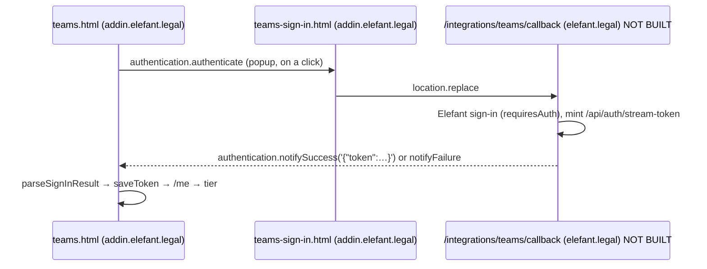

# Teams app: what was built, why, and how to install it (17 Nov 2026)

Issue #78. The owner, 17 Nov: "where's the manifest file? only teams add-in available, which we should add as well btw."

## Decision

Ship a **Teams app of its own: one personal (static) tab**, packaged as a `.zip` (manifest.json + two icons), built from this repository. The Word add-in stays on its XML manifest. The tab is the same Vite build, served from the same origin as the task pane (`https://addin.elefant.legal/teams.html`), and reuses the task pane's settings, sign-in, review call and results components.

Why, from Microsoft's pages (read 17 Nov 2026):

1. **One package for Word and Teams is not possible today.** "Outlook add-ins are the only kind of Office add-in that can be combined with a Teams app. We're working hard to support this feature for Excel, PowerPoint, and Word add-ins too." [Combining an add-in and a Teams app](https://learn.microsoft.com/en-us/microsoftteams/platform/m365-apps/overview-combining-add-in-and-teams-app) (ms.date 2026-06-23). So: two packages, two uploads.
2. **A personal tab is a web page in an iframe.** "Tabs are client-aware webpages embedded in Microsoft Teams, Outlook, and Microsoft 365. They're simple HTML `<iframe/>` tags that point to domains declared in the app manifest" … "Personal (static) tabs … are part of the personal apps that are scoped to a single user and pinned to the left navigation bar". The page must "add the Teams JavaScript client library … and call `microsoftTeams.app.initialize()` after your page loads." [Tabs in Microsoft Teams](https://learn.microsoft.com/en-us/microsoftteams/platform/tabs/what-are-tabs) (ms.date 2026-08-27). Our task pane is already such a page, so this is the smallest shape that reuses it.
3. **A message extension needs a hosted service registered as a bot**, which we do not have: "A message extension is composed of an agent runtime service that you create with Teams SDK and host … so you must register your web service as a bot." (API-based ones need an OpenAPI description and support search only.) [Message extensions](https://learn.microsoft.com/en-us/microsoftteams/platform/messaging-extensions/what-are-messaging-extensions) (ms.date 2026-10-07). Later, if wanted.
4. **The unified manifest and Word.** The Word add-in could move to the JSON manifest on its own (supported on "Office on the web: Yes"; "Excel, PowerPoint, and Word on Windows (Version 2501 (18407.20002) or later) connected to a Microsoft 365 subscription: Yes"; "… on Mac (Version 16.103 (25101427) or later): Yes"; "Office on Windows (perpetual versions): No"; "Office on mobile: No") [Unified manifest overview](https://learn.microsoft.com/en-us/office/dev/add-ins/develop/unified-manifest-overview) (ms.date 2026-10-14). The page does not say "preview" or "generally available" for Word. Moving would drop perpetual Office, and it still would not merge with Teams (point 1), so it is not part of this work.
5. **Manifest version 1.29**: the newest under "All generally available versions" on the [schema reference](https://learn.microsoft.com/en-us/microsoft-365/extensibility/schema/) (1.29, June 2026; changes after it are under "What's new in developer preview"). Cross-host surfacing needs "greater than or equal to v1.13" ([Integrated apps, cross-host](https://learn.microsoft.com/en-us/microsoft-365/admin/manage/teams-apps-work-on-outlook-and-m365)).

### Sign-in: Elefant's own sign-in in a Teams popup, not Teams SSO

- Teams SSO (`getAuthToken`) yields a Microsoft Entra token, needs an Entra app registration, an Application ID URI and manifest `webApplicationInfo`, and "fails for anonymous users as they aren't Microsoft Entra accounts". [SSO in tabs](https://learn.microsoft.com/en-us/microsoftteams/platform/tabs/how-to/authentication/tab-sso-overview). Elefant accounts are BetterAuth accounts, not Entra identities, and the API does not accept Entra tokens. So SSO would mean backend work and an owner registration for no gain in this slice.
- Third-party sign-in in a tab: identity providers refuse iframes, so "add a page to host the identity provider that Teams client displays inside a pop-up window … Use the `authentication.authenticate()` function". "Authentication flow must start on a page that's on your domain. This domain should also be listed in the `validDomains` section of the manifest. Failure to do results in an empty pop-up." The last page calls `authentication.notifySuccess()` or `notifyFailure()`. "Trigger the authentication flow by a user action." [Configure OAuth authentication for tab](https://learn.microsoft.com/en-us/microsoftteams/platform/tabs/how-to/authentication/auth-tab-aad) (ms.date 2026-03-16).
- Docs silent: whether the page that calls `notifySuccess` must itself be in `validDomains` when it is not the start page. We list `elefant.legal` there anyway (it is ours).



## What is in the repository

| Path | What |
|---|---|
| `scripts/teams-package.mjs` | `pnpm teams:package` → `teams/dist/elefant-teams-<version>.zip`. Constants: `MANIFEST_VERSION`, `TEAMS_APP_ID`, `DEFAULT_TAB_ORIGIN`, `SIGN_IN_ORIGIN` (equal to the redirect in `public/teams-sign-in.js`); env `TEAMS_TAB_ORIGIN` |
| `teams/color.png`, `teams/outline.png` | 192×192 colour, 32×32 white-on-transparent outline ("Full‑bleed color icon 192 × 192 px", "Default (rest) icon 32 × 32 px": [app icons](https://learn.microsoft.com/en-us/microsoftteams/platform/concepts/design/design-teams-app-icon-store-appbar)). Generated from the task-pane "E" icon; placeholders until brand art exists |
| `teams.html`, `src/teams.tsx`, `src/TeamsApp.tsx` | The tab page: no office.js; `app.initialize()`, registers the Teams sign-in, then the app |
| `src/components/panels/PastedReviewPanel.tsx` | Paste text → the same `reviewText` + `ReviewResults` as the Word pane, without Insert |
| `src/lib/teams.ts` | The only Teams boundary: start the SDK, sign in through the popup, parse its result. Imported only by the Teams entry, so the Word pane's bundle does not carry TeamsJS |
| `public/teams-sign-in.html/.js` | The popup's first page; redirects to the Elefant Teams callback |
| `src/api/auth.ts`, `src/hooks/useAuth.ts` | `setClickOnlySignIn`: a host whose popup may only open on a click registers its sign-in; `openLoginDialog` then uses it, and the refresh timer does not reopen sign-in. Word path unchanged |

`TEAMS_APP_ID` is the Teams app's own id (any GUID, kept stable so a re-upload is an update). It is not an Entra id, and no Entra id is needed for this slice.

Validation: the zipped manifest was checked against Microsoft's published schema (`https://developer.microsoft.com/json-schemas/teams/v1.29/MicrosoftTeams.schema.json`, draft-04) with Python `jsonschema`: 0 errors; the same check reports a removed `accentColor`. Draft-04 does not enforce `const`, so `manifestVersion` is guarded by the vitest test instead. To repeat:

```sh
pnpm teams:package && mkdir -p /tmp/teams-pkg && unzip -o teams/dist/elefant-teams-*.zip -d /tmp/teams-pkg
curl -sSfL -o /tmp/teams-schema.json https://developer.microsoft.com/json-schemas/teams/v1.29/MicrosoftTeams.schema.json
uv run --with jsonschema python -c "import json,jsonschema; jsonschema.Draft4Validator(json.load(open('/tmp/teams-schema.json'))).validate(json.load(open('/tmp/teams-pkg/manifest.json'))); print('valid')"
```

Microsoft's own validator is the Developer Portal's store validation (https://dev.teams.microsoft.com/tools/store-validation); it needs a Microsoft sign-in, so it was not run.

## Rough edges (honest 80%)

- **Pro sign-in in Teams does not complete until the web app has `/integrations/teams/callback`.** The existing `/integrations/word/callback` speaks only Office's `messageParent`. The new page: `requiresAuth`, fetch `/api/auth/stream-token`, load `@microsoft/teams-js`, `app.initialize()`, then `authentication.notifySuccess(JSON.stringify({ token }))`, or `notifyFailure(JSON.stringify({ error: 'token_unavailable' }))`. It does not load office.js, so it does not depend on #72's `replaceState` fix. Constraints from [auth-tab-aad](https://learn.microsoft.com/en-us/microsoftteams/platform/tabs/how-to/authentication/auth-tab-aad): call `app.initialize()` before `notifySuccess`; do not send `Cross-Origin-Opener-Policy: same-origin` or `same-origin-allow-popups` on the sign-in pages ("it disrupts the connection to the parent window and causes the authenticate API call to return prematurely with a `CancelledByUser` error"). The token travels in `notifySuccess`'s result string, where Microsoft's sample passes only a localStorage key; that is not possible across the two origins. Monorepo work; not done here.
- Free BYOK review works in the tab once a Gemini key is entered in Settings, subject to #71 (the model list).
- In Teams the session is not renewed on a timer (Teams: "Avoid opening the authentication pop-up automatically, as this is likely to trigger the browser's pop-up blocker"), so a Pro user signs in again when the token expires. A "Sign in again" prompt is a follow-up.
- Inside a non-Teams iframe, TeamsJS waits for its initialisation time-out before the tab mounts; outside any frame it fails at once. Only matters when the page is opened outside Teams.
- `nginx.conf` sets no CSP `frame-ancestors` (nor `X-Frame-Options`), which is why Teams can frame the tab today, and also why any site can frame the task pane and the tab, where the Gemini key and Elefant token live in localStorage. Microsoft's tab list: "`*.cloud.microsoft`; Teams `teams.microsoft.com`, `*.teams.microsoft.com`; Microsoft 365 app `*.microsoft365.com`, `*.office.com`" ([tab requirements](https://learn.microsoft.com/en-us/microsoftteams/platform/tabs/how-to/tab-requirements)). Not changed here: the same header serves the Word pane, whose Office web host list must be read from the Office docs first, or Word on the web breaks. Follow-up issue to file (an agent's attempt to file it was not permitted).
- DRY: `TeamsApp` repeats `App`'s three provider setups (~15 lines) and `public/teams-sign-in.*` mirrors `public/sign-in.*`. Kept apart so the Word entry and its tests stay untouched.
- Nothing has been opened in real Teams.

## Sideload it yourself (a person, a Teams account whose policy allows custom app upload)

Microsoft's steps ([Upload your custom app](https://learn.microsoft.com/en-us/microsoftteams/platform/concepts/deploy-and-publish/apps-upload), ms.date 2026-10-09). The tab page must be live: either the deployed `addin.elefant.legal` serving `teams.html` (needs a deploy of this branch; owner-gated), or a local dev server.

1. In this repository: `pnpm install --frozen-lockfile && pnpm teams:package`. For a local test instead: `pnpm certs` once, `pnpm dev`, then `TEAMS_TAB_ORIGIN=https://localhost:3000 pnpm teams:package`, and open `https://localhost:3000/teams.html` in the same browser first to confirm the certificate is trusted. (Microsoft's pages read here do not say whether a localhost tab loads in Teams outside their toolkit; untested.)
2. Open Teams (desktop or https://teams.microsoft.com) signed in with the work account.
3. **Apps** > **Manage your apps** > **Upload an app**.
4. **Upload a custom app** → choose `teams/dist/elefant-teams-0.1.0.zip`.
5. **Add**, then **Open**. The Elefant tab opens in the left bar.
6. Check: the page shows "Elefant", a paste box, and **Review Text** (disabled) with "Add your Gemini API key in Settings…".
7. **Settings & sign in** → paste a Gemini key → close → paste ≥10 characters of contract text → **Review Text**. Expect a summary and issues, and no Insert buttons.
8. **Settings & sign in** → **Sign in to Elefant**. Expect a popup on `addin.elefant.legal/teams-sign-in.html` that moves to `elefant.legal` and the Elefant sign-in. Until the callback page exists, it will not hand back to the tab: record what you see.
9. If upload is refused: the tenant does not allow custom app upload (see owner step 1).

## Owner steps (none done by an agent)

1. **Allow custom app upload for yourself** (Teams admin centre; [custom app policies](https://learn.microsoft.com/en-us/microsoftteams/teams-custom-app-policies-and-settings), ms.date 2026-04-14): **Teams apps** > **Setup policies** → the policy → **Upload custom apps** On → **Save**; and in Org-wide app settings, **Let users interact with custom apps in preview** On.
2. **Deploy this branch** so `https://addin.elefant.legal/teams.html` and `/teams-sign-in.html` exist (`pnpm run deploy`, owner-gated). No nginx change is needed: the CSP sets no `frame-ancestors`, so Teams may frame the page.
3. **Have the monorepo build `/integrations/teams/callback`** (above). Without it, Pro sign-in in Teams stops at the Elefant page.
4. **Org-wide rollout**, either:
   - Teams admin centre: **Teams apps** > **Manage apps** > **Upload new app** (or **Actions** > **Upload new app**) → the zip. "The uploaded app is available to the org users after a few hours." Same page as step 1.
   - Microsoft 365 admin centre: **Settings** > **Integrated apps** > **Upload custom apps** → **App type: Teams App** → the zip → **Next** → **Add users** (Just me / Specific users/groups / Entire organization) → **Next** → **Accept permissions** if shown → **Finish deployment**. Microsoft: changes there "only impact these apps on Outlook and the Microsoft Copilot application. To manage how these apps show up on Teams, use the Teams admin center." Global Administrator only. ([cross-host apps](https://learn.microsoft.com/en-us/microsoft-365/admin/manage/teams-apps-work-on-outlook-and-m365), ms.date 2025-08-26)
   - Recommendation: Teams admin centre, because that is the console that decides what shows in Teams.
5. **Approve wording** (below) and replace the placeholder icons with brand art if wanted.

## PROPOSED public wording (in `scripts/teams-package.mjs`; needs the owner's yes)

- `name.short`: "Elefant" · `name.full`: "Elefant Legal Assistant" (the XML manifest's DisplayName)
- `description.short`: "AI-powered legal document review and analysis" (the XML manifest's Description)
- `description.full`: "Paste contract text into Elefant and get a summary and the issues worth a lawyer's attention. Use your own Gemini API key, or sign in with an Elefant account."
- `developer.name`: "Elegant Elephant Pte Ltd" (the XML manifest's ProviderName); `privacyUrl` https://elefant.legal/privacy-policy and `termsOfUseUrl` https://elefant.legal/terms-and-condition (both returned 200 on 17 Nov)
- Tab name: "Review"; button "Review Text"; placeholder "Paste the text to review..."; error "Paste at least 10 characters to review."; header button "Settings & sign in".
