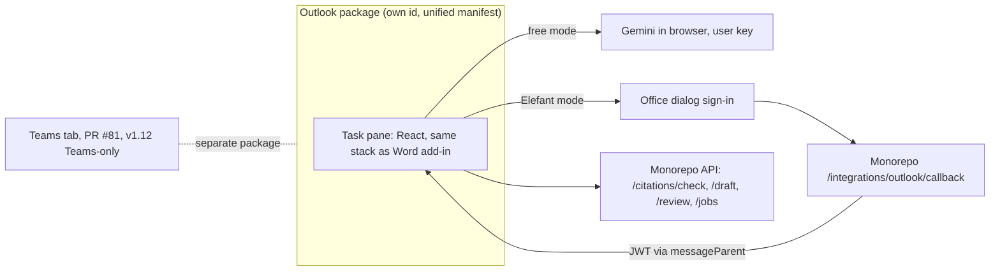

# Elefant Outlook add-in: plan (2026-11-18)

Status: plan only, no code. Sources are Microsoft Learn pages read on 2026-11-18, quoted with links. Where the docs say nothing, this says so. User-facing wording is PROPOSED.

## 1. Unified manifest for Outlook add-ins today

Source: [Office Add-ins with the unified app manifest](https://learn.microsoft.com/en-us/office/dev/add-ins/develop/unified-manifest-overview#client-and-platform-support) (updated 2026-10-14).

| Client | Unified manifest |
|---|---|
| Outlook on the web | Yes ("Office on the web: Yes") |
| New Outlook on Windows | "Yes, but see Feature support." |
| Outlook on Windows (classic) | "Version 2307 (Build 16626.20132) or later connected to a Microsoft 365 subscription. Yes, but see Feature support." |
| Outlook on Mac | **No** |
| Outlook / Office on mobile | **No** |
| Office on Windows, perpetual | No |

- "Add-ins that use the unified manifest can't be installed on all platforms ... you must create and deploy two versions of the add-in; one that uses the unified manifest and one that uses the add-in only manifest."
- "Add-ins that use the unified manifest can't be installed for users whose mailboxes are hosted on an on-premises Exchange Server rather than Exchange Online."
- Not yet supported in Outlook: OnMessageReadWithCustomAttachment, OnMessageReadWithCustomHeader, multi-item select (classic only), spam reporting (classic only).
- GA or preview: **the docs never use the word GA for the unified manifest in Outlook.** [Office Add-ins manifest](https://learn.microsoft.com/en-us/office/dev/add-ins/develop/add-in-manifests) says only the add-in only (XML) manifest "can be used for production add-ins". The overview's sample uses `"manifestVersion": "devPreview"` and the DevPreview schema. Treat the production status as unconfirmed; ask Microsoft or test a tenant before promising it to customers.
- Minimum versions for the mailbox APIs we need are not stated on these pages; the sample manifest uses Mailbox requirement sets 1.1 to 1.10.

## 2. Combining with the Teams app

Sources: [Combining an Office add-in and a Teams app](https://learn.microsoft.com/en-us/microsoftteams/platform/m365-apps/overview-combining-add-in-and-teams-app), [Apps for Microsoft 365 across hosts](https://learn.microsoft.com/en-us/microsoft-365/admin/manage/teams-apps-work-on-outlook-and-m365), [Extend a personal tab](https://learn.microsoft.com/en-us/microsoftteams/platform/m365-apps/extend-m365-teams-personal-tab).

**Can one package carry both?** Yes, for Outlook only: "Outlook add-ins are the only kind of Office add-in that can be combined with a Teams app." The Word add-in cannot join it.

**What manifest version?** The docs do not name one for the combined package. What they do say:
- The add-in side needs the unified manifest (the sample is `devPreview`).
- To surface in Outlook or Microsoft 365, "a app for Microsoft 365 must use a version of the unified manifest ... greater than or equal to v1.13."
- PR #81 is on v1.12, so combining means leaving 1.12. The exact target (1.13 up to 1.20, or devPreview) is unspecified; the personal-tab tutorial's example is 1.20.

**What happens to "Teams-only"?** At 1.13 or later the tab is no longer Teams-only: "After it's uploaded to Teams, your personal tab is available in Outlook and Microsoft 365 app." Admin table: Teams apps below 1.13 are managed "Teams only"; at 1.13 or later they are managed for "Outlook, Microsoft 365 App, Teams" by an Azure Application Admin. The docs say you can "omit it from surfacing in contexts that you're not ready to support" via runtime requirements ([specify runtime requirements](https://learn.microsoft.com/en-us/microsoftteams/platform/m365-apps/specify-runtime-requirements), not read in full). Docs are silent on whether `authentication.authenticate` works in the Outlook host: "Only a subset of Teams application types and capabilities are supported in Outlook"; check `isSupported()` at runtime. Tab prerequisites in other hosts: TeamsJS 2.19.0 or later, `*.cloud.microsoft` in `frame-ancestors`, eight client IDs added to the Entra app for SSO.

**Recommendation: two packages.**
1. Keeps the deliberate Teams-only choice. One package at 1.13+ puts the tab in Outlook and the Microsoft 365 app by default, and our popup sign-in is untested there.
2. Unified-manifest add-ins miss Outlook Mac and mobile, so we would carry an XML twin anyway. A combined package makes that three artefacts.
3. Updating a combined package needs admin consent or per-user consent; add-in-only users "must acquire the new combined app from the Teams store".
4. Different admins: Application Admin for the cross-app side; Exchange admin for the add-in.
5. Cheap to merge later: the docs require the merged manifest to keep "the same value as the 'id' property in the original Teams app manifest", so merging is a manifest bump on the Teams app. Give the Outlook package its own id now; revisit in Phase 4.

Counterpoint: Microsoft recommends combining "closely related or overlapping" apps. Ours differ (a tab versus mail commands), so we do not follow it.

## 3. Sign-in

Sources: [NAA how-to](https://learn.microsoft.com/en-us/office/dev/add-ins/develop/enable-nested-app-authentication-in-your-add-in), [NAA requirement set](https://learn.microsoft.com/en-us/javascript/api/requirement-sets/common/nested-app-auth-requirement-sets), [Office dialog API auth](https://learn.microsoft.com/en-us/office/dev/add-ins/develop/auth-with-office-dialog-api).

- NAA is GA in Outlook on Windows, web, Mac, iOS, Android. NestedAppAuth 1.1 minimums: Windows (M365) 2409 (18025.20000), Mac 16.89, iOS/Android v4.2433.0, web supported. Declaring it in the manifest "isn't supported"; check `isSetSupported('NestedAppAuth','1.1')`. "In Outlook, the NestedAppAuth 1.1 requirement set isn't supported if the add-in is loaded in an Outlook.com or Gmail mailbox."
- NAA gives MSAL tokens for **our Entra app registration** (Microsoft identities only). It does not sign anyone into Elefant, whose accounts are BetterAuth. Docs are silent on exchanging an Entra token for a non-Microsoft API. That would need the monorepo to accept Entra tokens: a backend decision, not made here.
- The Office dialog API is the documented route "for scenarios where you don't want to use single sign-on (SSO), or can't use SSO". An Outlook sample is listed. Docs are silent on its minimum Outlook versions. Our popup in the Word add-in already uses it (`src/api/auth.ts`: `/sign-in.html` redirecting to the monorepo callback, token back by `messageParent`), which the docs recommend over shared storage.
- The Teams `authentication.authenticate` popup is a TeamsJS call. It is not an add-in mechanism.
- Answer: **the Office dialog flow to Elefant works inside Outlook and is the MVP.** Add NAA only if the backend takes Entra tokens. BYOK mode needs no sign-in.

## 4. Sideloading and admin deployment

Sources: [sideload (Outlook)](https://learn.microsoft.com/en-us/office/dev/add-ins/outlook/sideload-outlook-add-ins-for-testing), [sideload (unified)](https://learn.microsoft.com/en-us/office/dev/add-ins/testing/sideload-add-in-with-unified-manifest), [integrated apps](https://learn.microsoft.com/en-us/microsoft-365/admin/manage/test-and-deploy-microsoft-365-apps), [add-in portal](https://learn.microsoft.com/en-us/microsoft-365/admin/manage/manage-deployment-of-add-ins).

- Sideload: Agents Toolkit F5 (Outlook Desktop; sign in to Microsoft 365 first), `npx office-addin-debugging start <manifest> desktop`, or build a zip and `atk install --file-path <zip>`. Also "manually sideloaded through the Teams app store, even if they have no Teams-related functionality" (Apps, Manage your apps, Upload a custom app). Limits: "Currently, it can't be sideloaded on iPad or on Outlook on Mac"; "Add-ins can't be directly sideloaded in Outlook on mobile".
- Admin: "Only add-ins that use the add-in only manifest can be deployed from the add-in portal ... To deploy an add-in that uses the Microsoft 365 unified manifest, you must use the integrated apps portal." There: Settings, Integrated apps, Upload custom apps, then upload the zip, choose users or groups, accept permissions, finish. The cross-app page lists the type as "Teams App"; the docs do not say which type a pure Outlook add-in zip takes (silent).
- Roles: Global admin, AI admin, Azure Application admin, Exchange admin; "Exchange Admins can edit any controls for Outlook add-ins deployed by them". Not available in sovereign or government clouds. Ribbon icons "can take 24-72 hours to appear". Admin deployment is also one of two routes to older or perpetual Office clients (the combining page).

## 5. First actions (legal assistant)

Routes found in the Word add-in (`src/api/*.ts`) and present in `origin/dev:backend/openapi.json`: `POST /citations/check`, `POST /draft`, `POST /review`, `POST /research`, `GET /jobs/{job_id}` and `/result`, `GET /me`. The contract has no route named stream-token (a token grep matches only `/unsubscribe/{token}` and a Slack workspace-token route), and the Word code does not use one. Confirm the stream-token route names with the monorepo owners before Phase 2. The Word add-in authenticates with a bearer JWT through `apiFetch`.

| # | Action | Surface | Elefant mode | Free (BYOK) mode |
|---|---|---|---|---|
| 1 | Check citations in this draft | compose | read body text, `POST /citations/check`, poll the job (same as `src/api/citations.ts`). No new route. Gate with `planIncludes(me, "citationCheck")`. | None: needs the API. Show the nudge. |
| 2 | Draft a reply | compose | `POST /draft` with the instruction plus thread text; insert at cursor. Word uses `/draft` for clauses, so a reply-shaped prompt needs a quick API check. Gate on `draft`. | Gemini in the browser, as `src/lib/agent.ts` does for clauses. |
| 3 | Summarise this thread | read | `POST /review` with the thread text; confirm its result carries a usable summary (the free schema has one). | Gemini in the browser. |

Order: 1 first (no new API surface), then 2, then 3. Quota and plan refusals map through `isPlanLimit` and `PLAN_LIMIT_REASONS`. Upgrade copy only through `UpsellContext` / `PRICING_URL`.

PROPOSED wording (not final):
- Free mode, citations: "Citation checks use your Elefant account. Sign in to run one."
- Plan limit: "This is not included in your current plan. See plans."
- Consent, first run: "To do this, the email text is sent to Google (your key) or to Elefant (your account)."

## Phases

| Phase | Scope | Size |
|---|---|---|
| 0. Decide | Confirm the unified manifest's production status with Microsoft; decide the Mac and mobile stance (XML twin or not); decide the NAA question with the backend; confirm stream-token routes. | S |
| 1. MVP | Unified-manifest package, own id. Compose task pane, free and Elefant modes. Dialog sign-in via a new monorepo outlook callback (the Word and Teams callbacks are the template). Action 1. Sideload via Agents Toolkit. | M |
| 2. Actions | Draft a reply (compose) and summarise a thread (read), plan gates and nudges. Mailbox permission set to the minimum read and compose. | M |
| 3. Deploy | Integrated-apps upload, test tenant, admin guide, Exchange-admin path. If Mac or mobile is needed, ship the XML twin (S to M) using the duplicate-manifest guidance. | M |
| 4. Revisit | Merge with the Teams package only if the tab is ready for Outlook and the Microsoft 365 app (needs 1.13+, runtime checks, CSP, SSO client IDs). Optional NAA if the backend takes Entra tokens. | L |

## Open items
- Production status of the unified manifest for Outlook (docs silent).
- Exact manifest version for a combined package (docs silent).
- Whether `authentication.authenticate` works in the Outlook host (docs silent).
- Which app type a pure Outlook add-in zip takes in "Upload custom apps" (docs silent).
- Whether `/draft` and `/review` suit replies and summaries as they stand.
